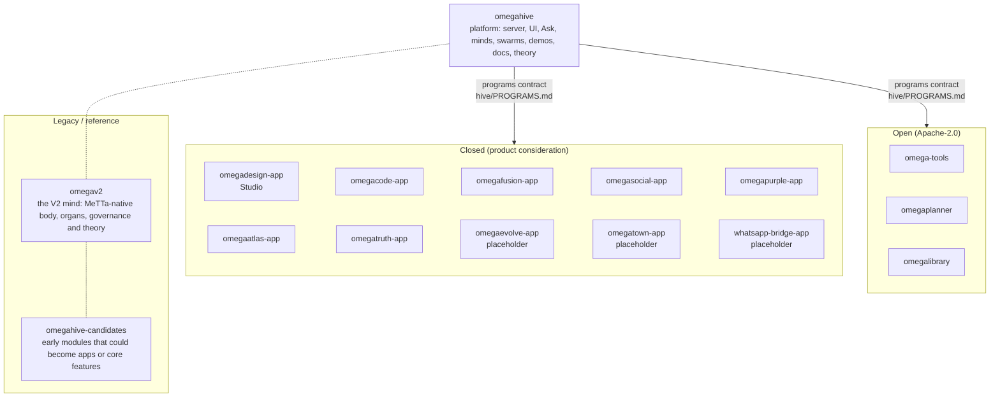

# OmegaHive handover: start here

> **Not yet reviewed.** This is handover material from PhysixSNET, published as received on 2026-10-23 so the review can happen in the open. Links still point to the original PhysixSNET repositories, which are private. The review and the fixes are tracked in this repository's issues.

This organisation holds the OmegaHive work, handed to the SingularityNET architecture team so it can be reorganised into the team's own repositories. Each repository is in one of two tiers, and is either public or private: the tables below say which. Which repositories are public is a management decision; an Open repo is published only after a secret scan.

| Tier | What it means |
|---|---|
| **Open (Apache-2.0)** | Can be reused and published under Apache-2.0. |
| **Closed Source for Product Consideration** | Shared privately with the SingularityNET team only. Do not publish, redistribute or relicense it as open source. Each closed repo has a `CLOSED_SOURCE.md`, a banner at the top of its README, and a notice in place of an open licence. |

If you split or move code, carry its tier with it.

## New to the code

Start with the [onboarding kit](onboarding/README.md): a learning track for your role, primers, a glossary, and the keep, harden or swap rubric. To take a whole team through it, use the [four-week rollout](onboarding/PROGRAM.md). For how everything fits together, with diagrams, component cards, the upgrade path, the threat model and the reviewer guide, see [`omegahive-schematics`](https://github.com/omega-flagship/omegahive-schematics).

## Current and legacy

| Status | What it covers |
|---|---|
| **Current** | `omegahive` (the `hive/` server and UI) and the app repos. This is the design going forward. |
| **Legacy / reference** | `omegav2` (an earlier, deeper mind design), `omegahive-candidates` (early modules), and the inherited OmegaClaw Core runtime and docs inside `omegahive` (`src/`, `modules/`, `channels/`, tutorials and references). These are outdated compared with the current hive and apps. Each is marked with a `LEGACY.md` file or a note at the top of the doc. See `omegahive/LEGACY.md` for the full map. |

## How the pieces connect

Start with `omegahive`: its `docs/START_HERE.md`, `docs/FEATURES.md` (every feature, its state and where it is), `docs/STATUS.md`, `docs/MODULARITY.md` (where the coupling is and what to split first) and `docs/EARLIER_EXPERIMENTS.md`.

## Repositories

The Closed app repos were renamed `<name>-app` on 2026-10-23; GitHub redirects the old names.

### Open (Apache-2.0)
| Repo | Visibility | What it is |
|---|---|---|
| `omegahive` | Private | The platform. Apache-2.0 except three Closed parts still inside it: `hive/plugins/omegaevolve` (Evolve), `hive/ui/src/experiences/omegatown` (OmegaTown) and the WhatsApp bridge (GPL-3 dependency). They have been copied to their own repos (below) and are removed from omegahive by [omegahive#1](https://github.com/omega-flagship/omegahive/issues/1). omegahive stays private until then. |
| `omegahive-start-here` | Public | This map: every repo, its tier and visibility, and the onboarding kit. |
| `omegahive-schematics` | Public | Diagrams and schematics for the whole platform: how it works, the intended shape, how to plug in, and what to review. Architecture review open: [omegahive-start-here#2](https://github.com/omega-flagship/omegahive-start-here/issues/2). |
| `omegahive-start-here-history`, `omegahive-schematics-history` | Private | The full history of the two repos above, before they were republished as one-commit copies on 2026-10-23, and their issues from before that date. |
| `omega-tools` | Public | Modular skills of thought and action. |
| `omegaplanner` | Public | Plan checker. |
| `omegalibrary` | Public | Knowledge node: pinned sources, page extraction, cited search. |
| `omegahive-candidates` | Public | **Legacy / reference.** Nine early modules: flow, match, alignment, reason, learn, atom, graft, chill, connect. |

### Closed Source for Product Consideration
All private. Which of them open later is a business decision, one at a time.

| Repo | What it is |
|---|---|
| `omegadesign-app` | Studio, the creative canvas app (UI source included). |
| `omegacode-app` | The Code service: coding workspaces, change sets, receipts. |
| `omegafusion-app` | Forecasting-society app. |
| `omegasocial-app` | Cross-hive channels and collaboration. |
| `omegapurple-app` | Purple-team detection-gap app. |
| `omegaatlas-app` | Personal scientific ledger and living map. Code only, with an invented example domain. |
| `omegatruth-app` | Evidence-investigation app, with its design papers. |
| `omegaevolve-app` | Evolve, the research-record registry. **Placeholder** until [omegahive#1](https://github.com/omega-flagship/omegahive/issues/1) is resolved. |
| `omegatown-app` | The OmegaTown experience and its Ask skin. **Placeholder** until [omegahive#1](https://github.com/omega-flagship/omegahive/issues/1) is resolved. |
| `whatsapp-bridge-app` | The WhatsApp bridge (GPL-3 dependency). **Placeholder** until [omegahive#1](https://github.com/omega-flagship/omegahive/issues/1) is resolved. |
| `omegav2` | **Legacy / reference.** The OmegaV2 mind: 194 MeTTa organs on PeTTa/SWI-Prolog, with design and theory papers. No memories or private data. A mind, not an app, so it keeps its name. |

### Also in this organisation
| Repo | Visibility | What it is |
|---|---|---|
| `Omega` | Public | A fork of `singnet/Omega`, with its workflows. |
| `omega-specs` | Public | Architecture decision records (ADRs) and glossary for SingularityNET Omega. |

## Other private repositories (access on request)
The owner holds further private research repositories. They are not part of this handover yet because they have not been through the privacy review applied here. Ask the owner for access to any of them:
- `omega-papers`
- `omega-experiments`
- `omega-methods`
- `omega-index`
- `physixCN/omegav2` (the reviewed V79 source that `omegav2` here was built from)
- `OmegaV2-HyperonStack`
- `fusion-poc-archive`
- `Symega`

OmegaClaw Core, the upstream runtime by Patrick Hammer, is public. It is credited in `omegahive/NOTICE`. Every upstream project, its licence and the papers behind it are in [Lineage and acknowledgements](ACKNOWLEDGEMENTS.md).

## Every repo has
- `README.md`: what it is, quick start and tests
- `STATUS.md`: what works and what is known broken, with test counts
- `CONTRIBUTING.md`, `CODE_OF_CONDUCT.md`, `SECURITY.md` and `CHANGELOG.md`

Toolchain for anything that runs reasoning: Python 3.12, SWI-Prolog 10.1.14 built against it, PeTTa at `ae66fa8`, janus-swi 1.5.3 and Node 22.12+. The `omegahive` README has the exact steps.

## Rules carried over
- Two independent reviewers before anything is deployed.
- No personal data in repos: people are named by role.
- Atlas and Truth data, and the V2 mind's memories, are never stored in any repository.
