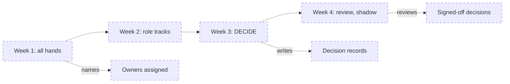
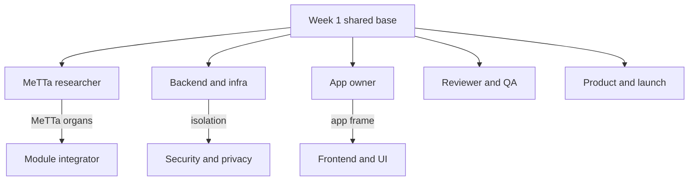

# A four-week rollout for a team

The [tracks](tracks/) are written for one reader. This page is a suggested plan for taking a whole organisation through them, then through the keep, harden or swap decisions, in four weeks. Change the pace to fit the team; keep the order.

**Who should read it.** Whoever runs the takeover. Track leads. Everyone who will own a repo or a component.

## The four weeks

The plan is dashed because it has not been run yet; every page it links to exists.

### Week 1: all hands

Everyone, whatever their role.

| Do | Where |
|---|---|
| The hive's nouns | the [hive-concepts primer](primers/hive-concepts.md), with the [glossary](GLOSSARY.md) open |
| The whole system on one page | [`omegahive-schematics/00-start/`](https://github.com/PhysixSNET/omegahive-schematics/blob/main/00-start/README.md), then [`LEGEND.md`](https://github.com/PhysixSNET/omegahive-schematics/blob/main/LEGEND.md) |
| What works and what is broken | [`omegahive/STATUS.md`](https://github.com/PhysixSNET/omegahive/blob/main/STATUS.md) |
| Run it once | the disposable local hive in [`omegahive/examples/SANDBOX.md`](https://github.com/PhysixSNET/omegahive/blob/main/examples/SANDBOX.md), with invented data only. It is not a security sandbox; read its limits first |

**By the end of week 1:**
- Each person has picked a track.
- Each track has a **track lead** who does the track during week 1, a week ahead of their cohort, and runs its checkpoint review in week 2.
- Every repo and every component card has a named owner (see [Owners](#owners) below).

### Week 2: role tracks

Each person does their [track](tracks/README.md), in cohorts by track. The tracks take about 6 to 8.5 hours each for one reader; leave time for the exercises to fail and be fixed. Use the prerequisites below to order a person who takes two tracks.

**By the end of week 2:** each person has done their track's checkpoint task, and the track lead has reviewed it.

### Week 3: DECIDE

Each component owner applies [DECIDE.md](DECIDE.md) to their components: score from evidence ([section 2](DECIDE.md#2-how-to-read-the-evidence)), fill the [score sheet](DECIDE.md#3-score-sheet), and write one [decision record](DECIDE.md#4-decision-record) per component: keep, harden or swap. A swap follows [section 5](DECIDE.md#5-how-to-swap-a-module-safely).

**By the end of week 3:** one decision record per component card, each with its evidence and its open questions.

### Week 4: review and shadow

- **Review.** Two independent reviewers read each decision record, as the repo rules require ([start-here README](https://github.com/PhysixSNET/omegahive-start-here/blob/main/README.md#rules-carried-over)). They check its claims against the code, not other docs.
- **Shadow.** Each new owner reproduces their component's evidence themselves: run its suites from a clean clone with the commands in [`10-testing/02-how-to-run.md`](https://github.com/PhysixSNET/omegahive-schematics/blob/main/10-testing/02-how-to-run.md), walk its [code tour](https://github.com/PhysixSNET/omegahive/blob/main/docs/CODE_TOURS.md) if it has one, and compare with what the record says. Record any difference.
- **Sign-off.** The role in the table below signs off each decision.

**By the end of week 4:** signed-off decisions, and a list of the hardening and swap work they create, ordered against the [launch checklist](https://github.com/PhysixSNET/omegahive-schematics/blob/main/09-security-and-launch/02-launch-readiness-checklist.md).

## Prerequisites between tracks

Everyone starts from the shared base (week 1). The other arrows are the suggested order for someone who takes both tracks, because the later track builds on pages the earlier one covers.

| Arrow | Why |
|---|---|
| Backend and infrastructure, then Security and privacy | the security track's isolation step builds on the supervisor, drivers and sandbox the backend track reads |
| MeTTa researcher, then Module and model integrator | a module is MeTTa skills and organs in a mind; the researcher track covers MeTTa and the mind's spaces |
| App owner, then Frontend and UI | the app frame is where an app's own UI meets the shell |

Security and privacy, Module and model integrator, and Frontend and UI can also start straight from the shared base; the arrows are an order, not a gate.

## Owners

Assign owners in week 1. Start every row unassigned and fill it in.

- **Per component:** the [ownership and evidence matrix](https://github.com/PhysixSNET/omegahive-schematics/blob/main/09-security-and-launch/03-ownership-and-evidence.md) has one row per component card, with its suggested lane, what it depends on, its sign-off role and where its evidence lives.
- **Per repo:**

| Repo | Tier | Owner | Natural track |
|---|---|---|---|
| `omegahive` | Open (three closed folders) | unassigned; split by component card | Backend and infrastructure |
| `omega-tools` | Open | unassigned | Module and model integrator |
| `omegaplanner` | Open | unassigned | App owner |
| `omegalibrary` | Open | unassigned | App owner |
| `omegadesign` | Closed | unassigned | App owner |
| `omegacode` | Closed | unassigned | App owner |
| `omegafusion` | Closed | unassigned | App owner |
| `omegasocial` | Closed | unassigned | App owner |
| `omegapurple` | Closed | unassigned | App owner |
| `omegaatlas` | Closed | unassigned | App owner |
| `omegatruth` | Closed | unassigned | App owner |
| `omegav2` | Closed, legacy | unassigned | MeTTa researcher |
| `omegahive-candidates` | Open, legacy | unassigned | Module and model integrator |
| `omegahive-schematics` | Open | unassigned | Reviewer and QA |
| `omegahive-start-here` | Open | unassigned | Product and launch |

Tiers are from the [start-here README](https://github.com/PhysixSNET/omegahive-start-here/blob/main/README.md#repositories). If you split or move code, carry its tier with it.

## Who signs off what

Sign-off is a role. Name a person for each role in week 1.

| Decision | Proposed by | Signed off by |
|---|---|---|
| Owner for each repo and component card | track leads | takeover lead |
| Keep, harden or swap one component | its owner, as a decision record | the sign-off role in its matrix row |
| A component with a security role (front door, gating, isolation, secrets, outside reach) | its owner | also the security lead |
| A change to truth semantics (commons revision, reasoning libraries, federation) | its owner | also the domain author for those semantics ([DECIDE.md](DECIDE.md#2-how-to-read-the-evidence), "Truth semantics have an owner") |
| A closed app, or a card with a closed side | the closed app's owner | also the platform lead |
| A launch checklist item changes state | the item's card owner, with evidence | launch lead |
| Launch | launch lead | launch lead with the security, platform and operations leads |

## References

- [Tracks](tracks/README.md), [DECIDE.md](DECIDE.md), [GLOSSARY.md](GLOSSARY.md)
- [Ownership and evidence matrix](https://github.com/PhysixSNET/omegahive-schematics/blob/main/09-security-and-launch/03-ownership-and-evidence.md)
- [Launch readiness checklist](https://github.com/PhysixSNET/omegahive-schematics/blob/main/09-security-and-launch/02-launch-readiness-checklist.md)
